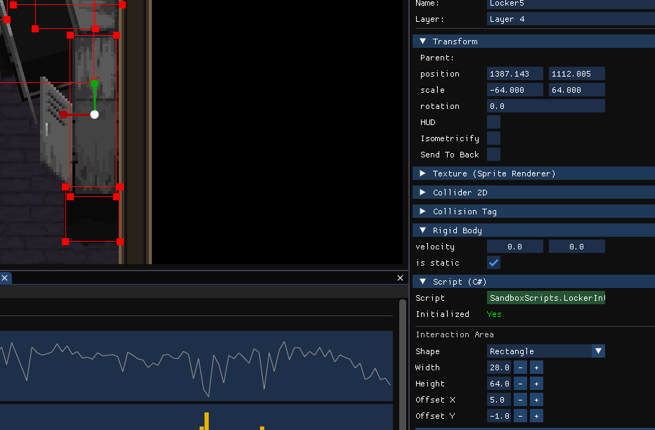

## Overview

NAgine is a custom 2D game engine written in C++, with an OpenGL renderer, an ImGui-based editor, an Entity Component System (ECS) architecture, and C# scripting through Coral. It powered our game *The Unraveling*.

## My Role

I was the technical lead, leading 6 developers (3 engine, 3 editor). I assigned tasks based on each person's strengths and workload, tracked progress against milestones, and enforced code quality through reviews and shared standards.

I designed and built most of the engine core:

 - **Engine architecture:** Designed the core engine loop and module structure, separated the engine from the editor, and moved the build to CMake.
 - **ECS:** Built the entity-component system, using sparse-set component arrays and a clean, simple API for gameplay code.
 - **Memory management:** Wrote a paged pool allocator with free-list allocation, bitmap tracking, and debug guards for overflows and use-after-free. Component storage can switch between pooled and dense-array allocation at runtime and reports allocation stats. Also built an LRU cache and a memory leak detector.
 - **C# scripting:** Built the Coral-based scripting host, C++/C# bindings and marshalling for every major system, and a Unity-style `SodiumBehaviour` component model that works directly with the ECS.
 - **Persistent services:** A service layer that lets C# game systems keep their state across scene changes.
 - **AI scripting bridge:** Let designers write AI states in C# that run on the engine's C++ state machine.
 - **Scenes and prefabs:** YAML serialization, scene management, entity cloning, and a prefab system.
 - **Live debugging tools:** A REST API debug server for inspecting and editing entities and components while the game runs, plus a companion web app showing a live minimap and game stats.
 - **Event system:** A publish-subscribe event bus to keep systems decoupled.
 - **Shipping:** Packaged *The Unraveling* with an Inno Setup installer and resolved certification (TCR) issues.